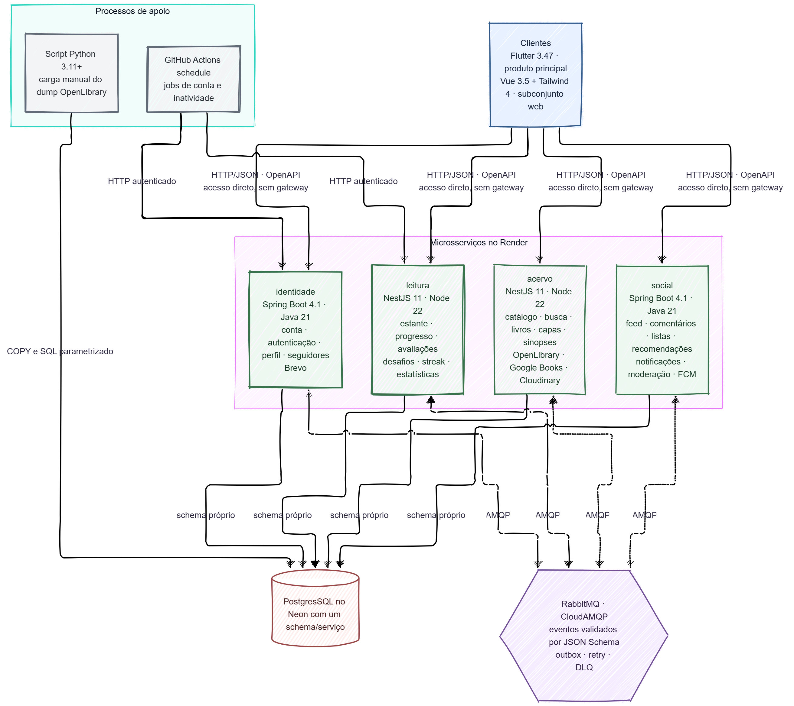

<!-- Documento DERIVADO do orquestador (docs/orquestador/documento-de-arquitetura.md §7
     e docs/orquestador/REQUISITOS.md §7, §8) para os cenários; as MEDIÇÕES vêm do sistema em DES.
     Não editar os cenários isoladamente. Ver docs/orquestador/plano-de-projeto.md §2.1.
     Estrutura: Template_Relatorio_ATAM_PUC_2026 (Relatório Técnico – Método ATAM), da disciplina
     de Arquitetura de Software. A versão .docx/.pdf para assinatura fica em assets/arquitetura/. -->

<a name="avaliacao"></a>

# 8. Avaliação da Arquitetura

_Relatório técnico da avaliação da arquitetura do Lê Ai pelo método ATAM (Architecture Tradeoff Analysis Method), na estrutura do template da disciplina. A versão para assinatura, no próprio template, está em [`assets/arquitetura/`](../assets/arquitetura/) (`.docx` e `.pdf`). Os cenários derivam dos requisitos não funcionais (`docs/3.requisitos.md`) e das decisões de arquitetura. As medições foram feitas em 19/11/2026 (uma segunda rodada do C-04 na noite de 20/11) com o sistema rodando em DES, na versão **v0.2.1** (Períodos 1 e 2), salvo onde indicado. Os dados brutos e os scripts estão em [`evidencias/atam/`](evidencias/atam/README.md) e [`code/scripts/atam/`](../code/scripts/atam/README.md)._

| Campo | Valor |
|---|---|
| Projeto avaliado | Lê Ai — aplicativo social de leitura |
| Data da avaliação | 19 e 20/11/2026 (medições) · 20/11/2026 (relatório) |
| Versão avaliada | v0.2.1 em DES (commit `f1f5c7e`; Render, Neon e CloudAMQP na região Oregon) |
| Método | SEI ATAM, com os cenários medidos no sistema em execução |

## 8.1. Resumo executivo

O Lê Ai é um aplicativo social de leitura: o app Flutter é o produto principal, e a web Vue cobre um subconjunto. Ele roda sobre quatro microsserviços em duas stacks (Spring e NestJS), um PostgreSQL único com um schema por serviço e mensageria RabbitMQ. A análise foi motivada por três escolhas que concentram o risco do projeto. A primeira é a privacidade de perfil e do livro pessoal: o produto é social, e o vazamento de um perfil privado quebra a confiança do leitor. A segunda é a infraestrutura em plano gratuito, com hibernação e limites de recurso. A terceira é a heterogeneidade proposital das stacks.

Seis cenários foram exercitados contra o sistema real:

- **Segurança atende.** 26 de 26 tentativas de acesso não autorizado foram negadas no DES, sem vazamento e sem alteração nos dados do dono.
- **Desempenho atende com folga.** A busca teve p95 de 296 ms com 10 clientes concorrentes, contra o limite de 1 s, já incluindo a ida e volta Brasil–Oregon.
- **Mensageria atende.** Outbox, idempotência, retentativa em 1/5/15 s e DLQ se comportaram como projetado sob falhas forçadas.
- **Manutenibilidade atende com ressalva.** Nenhum serviço lê tabela de outro nem importa código de outro, e as 117 operações dos contratos existem no runtime. Mas os specs gerados em runtime não declaram os códigos de erro que os YAMLs declaram.
- **Disponibilidade sob hibernação atende só em parte.** Os serviços Spring levaram cerca de três minutos para acordar (de 168 a 179 s, em duas rodadas), acima dos 30 a 60 s previstos e acima do timeout de 90 s dos clientes. A idempotência da escrita, que protege o reenvio, atende. O plano de ação (§8.7) trata esse risco primeiro.

## 8.2. Objetivos de negócio e direcionadores arquiteturais

O objetivo do produto é **aumentar a adesão à leitura entre leitores brasileiros adultos** por registro, meta e pertencimento (`docs/orquestador/REQUISITOS.md` §1). Desse objetivo e das restrições do projeto saem os direcionadores:

- **Direcionador 1 — Privacidade e controle de acesso (Segurança).** Perfil privado, livro pessoal e dados de leitura só chegam a quem tem direito, com validação no servidor (RNF-SEC-01 a 07; LGPD, com cadastro a partir de 18 anos).
- **Direcionador 2 — Resposta rápida nas leituras do dia a dia (Desempenho).** Busca, estante e feed respondem em até 1 s no p95 (RNF-DES-01/03, RNF-ARQ-04), porque registrar a leitura precisa ser um gesto curto.
- **Direcionador 3 — Operação em plano gratuito e em rede móvel instável (Disponibilidade e resiliência).** A hibernação do Render aparece como carregamento, não como erro, e o progresso registrado sem rede é reenviado sem duplicar (RNF-ERR-04/05/09, RNF-ARQ-08).
- **Direcionador 4 — Consistência entre serviços sem acoplamento síncrono (Resiliência assíncrona).** Feed, notificações e capas seguem eventos com outbox, idempotência e DLQ (RNF-ERR-06/07/10, RNF-ARQ-06).
- **Direcionador 5 — Evolução em duas stacks por cinco desenvolvedores (Manutenibilidade e interoperabilidade).** Contratos OpenAPI e JSON Schema versionados, e leitura entre schemas só por VIEW (RNF-ARQ-01/03).

## 8.3. Topologia e abordagem da arquitetura



_Fonte: [`diagramas/componentes.mmd`](diagramas/componentes.mmd). A decomposição, os dados e a mensageria estão detalhados no Documento de Arquitetura (`docs/orquestador/documento-de-arquitetura.md`)._

| Componente / camada | Tecnologia | Papel estrutural e mecanismo de comunicação |
|---|---|---|
| App móvel (produto principal) | Flutter 3.47 | Escopo funcional completo. HTTP/JSON direto a cada serviço, sem gateway; fila local de progresso offline com chave de idempotência; push Android por FCM |
| Web (subconjunto) | Vue 3.5 + Tailwind 4, site estático no Render | SPA com o subconjunto web do escopo. HTTP/JSON direto aos serviços; aviso de servidor iniciando durante o cold start |
| `identidade` | Spring Boot 4.1, Java 21 | Conta, autenticação (JWT de acesso curto + refresh revogável), perfil, privacidade e seguidores. Publica eventos de perfil e de conta pela outbox; expõe as VIEWs `v_perfil_referencia_v1` e `v_seguimento_aceito_v1` |
| `acervo` | NestJS 11, Node 22 | Catálogo, busca indexada, livro pessoal, capas (Cloudinary) e sinopses. Consome eventos de leitura (cache de capas) e de conta |
| `leitura` | NestJS 11, Node 22 | Estante, leitura, progresso, nota, resenha, desafios, sequência e estatísticas. Publica eventos de leitura pela outbox; expõe VIEWs públicas de estante, nota e resenha |
| `social` | Spring Boot 4.1, Java 21 | Feed, comentários, listas, recomendações, notificações (tempo real e FCM) e moderação. Consome eventos dos demais serviços |
| Banco de dados | PostgreSQL no Neon, um projeto por ambiente | Um schema por serviço. A leitura entre schemas usa só VIEW versionada, que o dono expõe como contrato |
| Mensageria | RabbitMQ (CloudAMQP) | Exchange por produtor, fila durável e DLQ por consumidor. Envelope único, validado por JSON Schema nas duas stacks |
| Processos de apoio | GitHub Actions (`schedule`) e script Python | Jobs diários por HTTP autenticado (exclusão de conta, inatividade); carga manual do dump OpenLibrary |

## 8.4. Árvore de utilidade e inventário de cenários

```
Utilidade
├── Segurança
│   ├── C-01 Perfil privado negado em todo endpoint ............ (Alta, Média)
│   └── C-02 IDOR e livro pessoal alheio ........................ (Alta, Média)
├── Desempenho
│   └── C-03 Busca com p95 ≤ 1 s sob clientes concorrentes ....... (Alta, Média)
├── Disponibilidade e resiliência
│   ├── C-04 Hibernação do Render e progresso offline ............ (Alta, Alta)
│   └── C-05 Mensageria com falha, duplicata e broker fora ....... (Média, Alta)
└── Manutenibilidade e interoperabilidade
    └── C-06 Contratos e acoplamento entre stacks ................ (Média, Média)
```

A prioridade está no formato (importância para o negócio, dificuldade técnica).

| ID | Atributo de qualidade | Descrição do cenário (estímulo, ambiente e resposta) | Prioridade (Negócio / Dificuldade) |
|---|---|---|---|
| C-01 | Segurança | **Controle de acesso a perfil privado:** um leitor tenta acessar a estante, as resenhas e as estatísticas de um perfil **privado** do qual **não** é seguidor aceito, inclusive tentando os endpoints de listagem e busca diretamente. O sistema deve negar o acesso em todos os endpoints, validando a relação de seguidor no servidor (RNF-SEC-01/02/03, RN-08), sem vazar o conteúdo protegido. | Alta / Média |
| C-02 | Segurança | **IDOR e livro pessoal:** um leitor, conhecendo o identificador de um **livro pessoal** de outro usuário, tenta adicioná-lo à estante, favoritar ou iniciar uma leitura. Essas mutações devem ser sempre negadas. A consulta por terceiro só pode ocorrer quando há uma referência válida no feed ou em uma lista do dono, com autorização e privacidade do perfil revalidadas na página; a substituição direta do ID não concede acesso (RNF-SEC-05/06/07, RN-15). | Alta / Média |
| C-03 | Desempenho | **Busca sob carga:** com múltiplos clientes concorrentes, uma busca de livros por título/autor/ISBN deve responder em **até 1 s no percentil 95**, desconsiderada a hibernação do plano gratuito, apoiada nos índices de busca (RNF-DES-01/03, RNF-ARQ-04). | Alta / Média |
| C-04 | Disponibilidade e resiliência | **Hibernação e offline:** a primeira requisição a um serviço hibernado do Render (cold start de 30–60 s) deve ser tratada como carregamento prolongado, não como erro; e o app móvel, sem conectividade, deve **enfileirar localmente** os registros de progresso e reenviá-los ao reconectar, sem perda nem duplicação (RNF-ERR-05/09, RNF-ERR-04/06). | Alta / Alta |
| C-05 | Resiliência assíncrona | **Mensageria:** uma mensagem de notificação que falha repetidamente no consumidor deve, após a tentativa inicial e retentativas em 1, 5 e 15 segundos, ir para a **dead-letter queue** sem bloquear a fila principal; e a entrega duplicada do mesmo `eventId` não deve gerar efeito em dobro (RNF-ERR-06/07, RNF-TST-03). | Média / Alta |
| C-06 | Manutenibilidade e interoperabilidade | **Microsserviços heterogêneos:** uma feature altera o contrato de um serviço (Spring ou NestJS). O impacto deve ficar contido pelos quatro OpenAPI versionados, pelas *views* de schema e pelos JSON Schemas de evento, sem que outro serviço dependa de tipo ou biblioteca interna do primeiro (RNF-ARQ-01/03, decomposição §3–4 da arquitetura). | Média / Média |

> **Decisão arquitetural (RNF-ERR-10):** cada produtor usa outbox transacional, gravando operação e evento na mesma transação; o dispatcher mantém retry até o *publisher confirm*. No consumidor, efeito de domínio e recibo de `eventId` são gravados na mesma transação. Filas duráveis e DLQ continuam protegendo as etapas posteriores. O envelope e os schemas canônicos estão em [`docs/mensageria/`](mensageria/README.md).

## 8.5. Resultados das medições

**Ambientes:**

- **DES:** Render (Oregon), Neon `le-ai-oregon` e CloudAMQP `Le-ai-oregon`, rodando a v0.2.1. O cliente estava no Brasil, então as latências incluem a ida e volta até Oregon. A linha de base da rede é a mediana de 252,5 ms de um `GET /health`.
- **Local:** `identidade` e `acervo` no mesmo commit, com RabbitMQ 4 e Postgres 17 em Docker. Usado só no C-05, para forçar falhas sem tocar o broker compartilhado.

Três contas de demonstração com e-mail `.invalid` foram criadas no DES pelo cadastro normal:

- `leai.demo.marina`: perfil privado;
- `leai.demo.caio`: seguidor aceito da Marina, perfil público;
- `leai.demo.bia`: não segue ninguém.

### C-01 — Perfil privado (DES)

A Bia (não seguidora), o Caio (seguidor aceito, como controle positivo) e uma chamada sem token tentaram as 7 rotas que expõem conteúdo da Marina: estante, resenhas e estatísticas do perfil (`leitura`); listas do perfil, lista, livros da lista e atividade do feed (`social`).

| Medida | Resultado |
|---|---|
| Tentativas da Bia negadas | **7 de 7** (6 × 403 e 1 × 404, cada um igual ao código que o contrato declara) |
| Conteúdo protegido no corpo das negações | **0** |
| Controles positivos (Caio) | 7 de 7 com 200 e o conteúdo esperado |
| Chamadas sem token | 7 de 7 com 401 |
| Rotas abertas por desenho | Cabeçalho do perfil, feed da Bia e resenhas na página do livro responderam 200, sem conteúdo do perfil privado (RN-08) |

### C-02 — IDOR e livro pessoal (DES)

| Medida | Resultado |
|---|---|
| Livro pessoal aberto sem via, com via que não o contém, ou de perfil privado que a Bia não segue | **5 de 5** negados (403) |
| Estante, favorito e leitura de livro pessoal alheio | **3 de 3** negados (403) |
| IDOR em leitura, progresso, exclusão de progresso e edição de lista alheios | **4 de 4** negados (404) |
| Livro pessoal aberto por via válida | 200 para a Bia num livro do Caio, pela lista dele (perfil público), e para o Caio num livro da Marina, pela lista dela (seguidor) |
| Busca do catálogo pelo título exato de um livro pessoal | 0 resultados |
| Estado do dono depois das tentativas | inalterado: 3 progressos antes e depois, mesmo último progresso, mesmo título de lista |

### C-03 — Busca sob carga leve (DES)

A carga rodou em ciclo fechado, com teto global de 10 req/s e 10 consultas reais: títulos, autores, 3 ISBN-13 do acervo de DES e um termo amplo. O acervo tinha 11.011 livros oficiais ativos. O percentil é nearest-rank, calculado sobre as respostas 200.

| Fase | Clientes | Requisições | Erros | p50 | **p95** | p99 | Máximo |
|---|---|---|---|---|---|---|---|
| A | 1 (30 s) | 117 | 0 | 250 ms | 322 ms | 424 ms | 435 ms |
| B | 5 (60 s) | 599 | 0 | 257 ms | 359 ms | 653 ms | 789 ms |
| C | 10 (60 s) | 600 | 0 | 256 ms | **296 ms** | 437 ms | 693 ms |

O critério do cenário é p95 ≤ 1.000 ms na fase C. **Atende.** Como complemento do RNF-DES-01, fora do cenário, 30 leituras sequenciais por rota deram p95 de 618 ms na estante própria, 873 ms no feed e 304 ms na estante de outro perfil. Todas ficam abaixo de 1 s, mas o feed é a leitura mais próxima do limite.

### C-04 — Hibernação e fila offline (DES)

**Cold start dos serviços.** Foi feito um `GET /health` em cada serviço, um de cada vez, depois de um período sem tráfego, em duas rodadas: 19/11 às 22:06 UTC, com limite de 180 s por chamada, e 21/11 às 00:58 UTC (noite de 20/11 no Brasil), com limite de 300 s. A tabela mostra o tempo até a primeira resposta; a segunda chamada, logo depois, levou de 0,2 a 0,4 s em todos os serviços (4,6 s no `identidade` da rodada 1).

| Serviço | Stack | Rodada 1 (19/11) | Rodada 2 (20/11) |
|---|---|---|---|
| `identidade` | Spring | **sem resposta em 180 s** (o script desistiu) | **200 em 176,9 s** |
| `acervo` | NestJS | 200 em 52,5 s | 200 em 47,9 s |
| `leitura` | NestJS | 200 em 57,6 s | 200 em 66,8 s |
| `social` | Spring | **200 em 167,5 s** | **200 em 179,4 s** |

Os serviços NestJS acordaram perto dos 30 a 60 s previstos (até 67 s). Os Spring levaram cerca de três minutos nas duas rodadas.

Os dois clientes usam **timeout de 90 s** por tentativa (`code/front/src/services/api.ts` e `code/mobile/lib/core/network/api_client.dart`). Eles fazem até três tentativas, com esperas de 1 e 3 s, mas só em GET e em escrita com chave de idempotência. Na prática:

- a primeira chamada a um serviço Spring hibernado pode estourar a primeira tentativa e depender da retentativa;
- uma escrita sem chave falha.

**Web.** No login da Marina na web do DES, o aviso "O servidor está iniciando. Isso pode levar alguns segundos." apareceu 0,9 s depois do clique, e a estante abriu em 6 s, sem tela de erro. Ressalva: a medição foi às 22:35 UTC, cerca de 14 min depois da última chamada ao `identidade`, então o serviço provavelmente não estava hibernado. Ela comprova o comportamento do aviso, mas não o tempo sob hibernação real.

**Reenvio idempotente (RNF-ERR-04).** Em 21/11 às 01:05 UTC, um `POST /leituras/{id}/progresso` da Marina foi enviado duas vezes com a mesma `Idempotency-Key`, como faz o reenvio da fila offline do app. As duas respostas foram 201 com o **mesmo progresso** e o mesmo conteúdo, e a leitura passou de 4 para 5 registros: **1 registro** com aquela página. O texto bruto das duas respostas difere só na ordem das chaves, porque o replay devolve o corpo guardado em `jsonb`.

**Fila offline do app (RNF-ERR-05).** O enfileiramento local e o reenvio são cobertos por testes automatizados que o CI roda a cada mudança (`code/mobile/test/features/progresso/progresso_test.dart`). A medição no app em DES (modo avião, 2 registros e reenvio) **não foi executada**. Por isso, o C-04 fica com ressalva.

### C-05 — Mensageria com falhas forçadas (local, Docker)

| Verificação | Resultado |
|---|---|
| `ping.teste` do `identidade` (Spring) ao `acervo` (NestJS) | Envelope publicado pela outbox e validado pelo mesmo JSON Schema nas duas stacks. O `correlationId` é o mesmo na outbox, nas propriedades AMQP, no recibo e no log do consumidor |
| Mesmo `eventId` entregue duas vezes | 2 entregas confirmadas, **1 recibo** e 1 efeito; DLQ vazia |
| Schema inválido | Direto para a DLQ (0 → 1), sem retentativa; a mensagem válida seguinte foi consumida |
| Falha técnica transitória (tabela do recibo renomeada) | Tentativas com intervalos de **1.006, 5.005 e 15.002 ms**, depois DLQ (1 → 2). A mensagem seguinte foi processada depois da restauração |
| Broker parado durante uma escrita | `POST /perfis/{username}/seguir` respondeu **201 em 64 ms**. O evento ficou `pendente` na outbox e passou a `publicado` cerca de 10 s depois da volta do broker |

Efeito observado: com `prefetch=1`, a retentativa feita no próprio consumidor segura a fila daquele consumidor enquanto espera, cerca de 21 s por mensagem com falha transitória. A fila não trava, porque a mensagem vai para a DLQ no fim, mas as seguintes atrasam.

### C-06 — Contratos e acoplamento (DES e repositório)

| Medida | Resultado |
|---|---|
| Operações `implemented` dos YAMLs presentes no spec em runtime | **117 de 117** (`identidade` 24, `social` 33, `acervo` 15, `leitura` 45); nenhuma rota sobrando no runtime |
| Referência a tabela crua de outro schema | **0**. Os 40 achados brutos do padrão `<serviço>.<nome>` foram classificados um a um como nomes de evento, comentários, caminho de documento e chamada a cliente HTTP |
| Tabelas de outro schema declaradas no Drizzle | **0**; só VIEWs `v_*_v1` |
| Import de código ou pacote de outro serviço | **0**, em Java e em TypeScript |
| Divergências entre o runtime e o YAML | 34 `operationId` diferentes (o YAML usa nomes descritivos, o runtime usa o nome do método). 115 operações com conjunto de códigos diferente: em 111, o runtime só omite os códigos de erro que o YAML declara; em 4, o código de sucesso difere (`DELETE /me/conta` 202 × 200, `POST /me/conta/cancelar-exclusao` 204 × 200, `DELETE /admin/frases/{fraseId}` 204 × 200, `POST /internal/jobs/inatividade` 200 × 201) |

Os YAMLs de `docs/api/` são o contrato publicado (RNF-ARQ-03). O spec em runtime é gerado das anotações do código, que não declaram as respostas de erro. As 4 diferenças de código de sucesso precisam ser conferidas contra a resposta real de cada rota, porque a medição não chamou essas rotas de escrita.

## 8.6. Inventário analítico rastreável (saídas do ATAM)

### Riscos identificados (R)

- **R-01: Cold start dos serviços Spring acima do timeout dos clientes.**
  - Cenários afetados: C-04.
  - Componentes críticos: `identidade` e `social` no Render free; clientes web e móvel.
  - Descrição técnica: a JVM com Spring Boot, no plano gratuito, levou de 168 a 179 s para responder em duas rodadas (na primeira, o `identidade` passou de 180 s). O RNF-ERR-09 prevê de 30 a 60 s, e os clientes esperam 90 s por tentativa. O primeiro acesso do dia, que costuma ser o login (no `identidade`), pode cair em timeout. O aviso de servidor iniciando cobre a espera, mas não a falha.
- **R-02: Mecanismos transversais implementados duas vezes.**
  - Cenários afetados: C-01, C-02, C-06.
  - Componentes: os quatro serviços.
  - Descrição técnica: erro padronizado, correlation-id, rate limiting, idempotência e controle de acesso existem em Spring e em NestJS. O C-06 mostra isso no código: rate limiting, idempotência, escritor de erro e configuração de segurança do `social` são porte declarado das classes do `identidade`. Uma correção de segurança feita numa stack pode não chegar à outra.
- **R-03: A retentativa no consumidor atrasa a fila.**
  - Cenários afetados: C-05.
  - Componente: consumidores RabbitMQ (`prefetch=1`).
  - Descrição técnica: a espera de 1 + 5 + 15 s acontece dentro do consumidor. Por cerca de 21 s, as mensagens seguintes daquela fila esperam. Uma rajada de falhas transitórias atrasa o feed e as notificações.
- **R-04: DLQ sem reprocessamento automático.**
  - Cenários afetados: C-05.
  - Componente: DLQs por fila.
  - Descrição técnica: a mensagem que chega à DLQ só volta por ação manual. Sem alarme, um evento de feed ou de exclusão de conta pode ficar parado sem que ninguém perceba.
- **R-05: Spec em runtime menos completo que o contrato.**
  - Cenários afetados: C-06.
  - Componente: contratos OpenAPI.
  - Descrição técnica: o runtime não declara as respostas de erro e diverge em 4 códigos de sucesso. Um consumidor que gere cliente a partir do runtime terá um contrato mais pobre, e uma divergência real de código de sucesso pode passar despercebida.
- **R-06: Limites do plano gratuito (Neon e Render).**
  - Cenários afetados: C-03, C-04.
  - Componentes: Neon (0,25 a 2 CU, tempo ativo mensal) e Render free (hibernação após ~15 min sem tráfego).
  - Descrição técnica: a própria medição consumiu +764 s de tempo ativo do Neon. Um uso real maior pode esgotar a cota mensal.

### Pontos de não-risco (NR)

- **NR-01: Autorização no servidor em toda rota de perfil e de livro pessoal.**
  - Cenários afetados: C-01, C-02.
  - Descrição técnica: a relação de seguidor e a propriedade são validadas no serviço que guarda o dado, e o livro pessoal só abre por uma referência válida, revalidada na página. Foram 26 de 26 tentativas negadas, sem vazamento e sem alteração no dono.
- **NR-02: Busca indexada com folga.**
  - Cenários afetados: C-03.
  - Descrição técnica: os índices normalizados de título, autor e ISBN e os serviços sem estado mantiveram o p95 em 296 ms com 10 clientes, dos quais cerca de 250 ms são rede. Banco e serviços na mesma região eliminam a latência entre eles.
- **NR-03: A escrita síncrona independe do broker.**
  - Cenários afetados: C-05.
  - Descrição técnica: a outbox transacional grava o evento junto com a operação. Com o broker parado, o "seguir" foi confirmado em 64 ms, e o evento foi publicado sozinho depois da volta.
- **NR-04: Consumo idempotente.**
  - Cenários afetados: C-05, C-04.
  - Descrição técnica: o recibo do `eventId` é gravado na mesma transação do efeito (`ON CONFLICT DO NOTHING`), e a entrega duplicada é confirmada sem segundo efeito. No lado síncrono, a chave de idempotência por intenção cumpre o mesmo papel para o reenvio da fila offline.
- **NR-05: Isolamento entre serviços no banco único.**
  - Cenários afetados: C-06.
  - Descrição técnica: nenhuma leitura de tabela crua de outro schema e nenhum import entre serviços. A leitura cruzada usa só as VIEWs versionadas, que têm testes de contrato no CI.

### Tradeoffs técnicos (T)

- **T-01: Duas stacks × custo de manutenção.**
  - Cenários afetados: C-06, C-01.
  - Descrição técnica: Spring e NestJS demonstram interoperabilidade real e aproveitam o que cada parte da equipe domina, ao custo de implementar os mecanismos transversais duas vezes (R-02). A escolha foi manter as duas stacks e conter o custo com contratos e testes de contrato.
- **T-02: Banco único com schemas × isolamento físico.**
  - Cenários afetados: C-06, C-03.
  - Descrição técnica: um único PostgreSQL cabe no teto do plano gratuito e permite as junções da recomendação, ao custo de acoplamento físico. A regra "só VIEW entre schemas" recupera o isolamento lógico, e o C-06 confirmou que ela é seguida.
- **T-03: Retentativa no consumidor × simplicidade da topologia.**
  - Cenários afetados: C-05.
  - Descrição técnica: retentar dentro do consumidor dispensa filas de espera com TTL ou plugin de atraso no broker, ao custo de segurar a fila durante a espera (R-03).
- **T-04: Outbox × latência de publicação.**
  - Cenários afetados: C-05.
  - Descrição técnica: a outbox garante a consistência entre operação e evento e tira o broker do caminho síncrono, ao custo de o evento sair pelo dispatcher, com atraso (o ping foi publicado 0,9 s depois de gravado).
- **T-05: Plano gratuito × disponibilidade.**
  - Cenários afetados: C-04, C-03.
  - Descrição técnica: Render, Neon e CloudAMQP gratuitos zeram o custo do projeto acadêmico, ao custo da hibernação e dos limites de recurso (R-01, R-06).

### Pontos de sensibilidade (S)

- **S-01: Timeout dos clientes × tempo de cold start.** O valor de 90 s por tentativa decide se o primeiro acesso a um serviço Spring hibernado vira carregamento longo ou erro. Uma variação de segundos no tempo de subida da JVM muda o resultado do C-04.
- **S-02: Região do banco em relação aos serviços.** Com o banco em outra região, cada consulta ganha a ida e volta entre regiões; a mudança do banco para Oregon, em 25/09, tirou cerca de 170 ms por consulta. O feed, que já está em 873 ms no p95 e faz várias consultas, é o primeiro a passar de 1 s.
- **S-03: Revalidação do seguimento em cada rota de listagem.** A privacidade do C-01 depende de cada endpoint novo de listagem chamar a validação de seguidor. Uma rota esquecida vaza o conteúdo do perfil privado.
- **S-04: Chave de idempotência da intenção, não da tentativa.** Se o app gerar uma chave nova a cada reenvio da fila offline, o servidor passa a gravar registros duplicados de progresso.
- **S-05: `prefetch` e esperas do consumidor.** O atraso da fila sob falha (R-03) cresce com o `prefetch` e com a soma das esperas (1 + 5 + 15 s). Mudar qualquer desses valores muda o comportamento do C-05.

## 8.7. Plano de ação e recomendações técnicas

**Ações de curto prazo (mitigação crítica):**

1. **R-01:** aquecer `identidade` e `social` antes do uso esperado, com um `GET /health` agendado no GitHub Actions (o agendador do projeto) a cada 10 a 14 min nos horários de uso. Aumentar para 180 s o timeout da **primeira** tentativa no login e no cadastro, mantendo o aviso de servidor iniciando. Depois, medir de novo o C-04 com os serviços de fato hibernados.
2. **R-04:** criar um alarme de mensagens na DLQ na CloudAMQP e um roteiro de reprocessamento manual no `AGENTS.md` de cada serviço.
3. **R-05:** conferir as 4 diferenças de código de sucesso contra a resposta real e corrigir o lado errado (anotação ou YAML).
4. **C-04:** executar em DES a medição do app offline (modo avião, registros e reenvio), prevista no roteiro da avaliação.

**Ações de médio e longo prazo:**

1. **R-01 e R-06:** plano pago com instância sempre ativa para os serviços Spring, ou imagem nativa (GraalVM) para reduzir o tempo de subida.
2. **R-03:** trocar a retentativa no consumidor por filas de espera com TTL e dead-letter de volta para a fila principal, liberando o consumidor durante a espera.
3. **R-02:** testes de contrato comuns às duas stacks para os mecanismos transversais (formato do erro, correlation-id, rate limiting e 401/403/404), rodando contra os quatro serviços no CI.
4. **R-05:** gerar o YAML a partir do código, ou validar no CI que o spec em runtime e o YAML coincidem nos códigos de status.

## 8.8. Avaliação final

| Atributo | Cenários | Resultado | O que fica de risco |
|---|---|---|---|
| Segurança | C-01, C-02 | **Atende** | S-03: toda rota nova de listagem precisa validar o seguimento |
| Desempenho | C-03 | **Atende** | Feed a 873 ms no p95 em leitura sequencial, o mais perto do limite |
| Disponibilidade e resiliência | C-04 | **Atende parcialmente** | R-01 (cold start Spring de ~3 min); app offline verificado só por teste automatizado |
| Resiliência assíncrona | C-05 | **Atende** | R-03 e R-04 |
| Manutenibilidade e interoperabilidade | C-06 | **Atende com ressalva** | R-02 e R-05 |

A arquitetura cumpre, no sistema em execução, os direcionadores de privacidade, desempenho, consistência assíncrona e isolamento entre serviços. O ponto fraco é a combinação dos serviços Spring com o plano gratuito do Render, que ultrapassa o tempo de espera que os clientes toleram. É uma limitação de infraestrutura com mitigação barata (§8.7, ação 1), não uma falha da decomposição.

**Limites desta avaliação:**

- As medições são da v0.2.1, sem as features do Período 3 (suspensão de conta, assuntos no livro pessoal, recomendação algorítmica e lembretes).
- A carga do C-03 foi leve de propósito, porque o DES é compartilhado, e não estabelece a capacidade máxima.

## 8.9. Evidências dos testes realizados

Todos os dados brutos estão em [`evidencias/atam/`](evidencias/atam/README.md), com horário em UTC e sem token, senha ou e-mail real. Os scripts que os geraram estão em [`code/scripts/atam/`](../code/scripts/atam/README.md).

| Cenário | Evidência |
|---|---|
| C-01 | [`cenario-1-resumo.txt`](evidencias/atam/cenario-1-resumo.txt), [`cenario-1-acessos.json`](evidencias/atam/cenario-1-acessos.json) |
| C-02 | [`cenario-2-resumo.txt`](evidencias/atam/cenario-2-resumo.txt), [`cenario-2-acessos.json`](evidencias/atam/cenario-2-acessos.json) |
| C-03 | [`cenario-3-resumo.txt`](evidencias/atam/cenario-3-resumo.txt), [`cenario-3-latencias.json`](evidencias/atam/cenario-3-latencias.json), [`cenario-3-consultas.json`](evidencias/atam/cenario-3-consultas.json) |
| C-04 | [`cenario-4-cold-start.json`](evidencias/atam/cenario-4-cold-start.json) (rodada 1), [`cenario-4-cold-start-2.json`](evidencias/atam/cenario-4-cold-start-2.json) (rodada 2), [`cenario-4-idempotencia.json`](evidencias/atam/cenario-4-idempotencia.json), [`cenario-4-web-cold-start.json`](evidencias/atam/cenario-4-web-cold-start.json) |
| C-05 | [`cenario-5-ping.txt`](evidencias/atam/cenario-5-ping.txt), [`cenario-5-duplicado.txt`](evidencias/atam/cenario-5-duplicado.txt), [`cenario-5-dlq-schema.txt`](evidencias/atam/cenario-5-dlq-schema.txt), [`cenario-5-retry.txt`](evidencias/atam/cenario-5-retry.txt), [`cenario-5-broker-fora.txt`](evidencias/atam/cenario-5-broker-fora.txt), [`cenario-5-testes-ci.txt`](evidencias/atam/cenario-5-testes-ci.txt) |
| C-06 | [`cenario-6-diferencas.txt`](evidencias/atam/cenario-6-diferencas.txt), [`cenario-6-acoplamento.txt`](evidencias/atam/cenario-6-acoplamento.txt), `cenario-6-runtime-<serviço>.json` |

Os testes automatizados que cobrem os mesmos mecanismos (RNF-TST-01/02/03) estão no [plano de testes](9.plano_de_testes.md) e rodam no CI de cada serviço.
